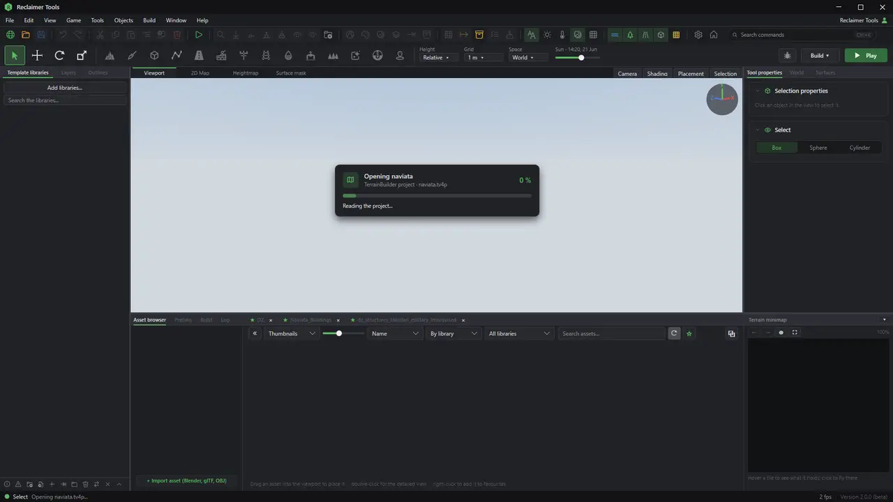
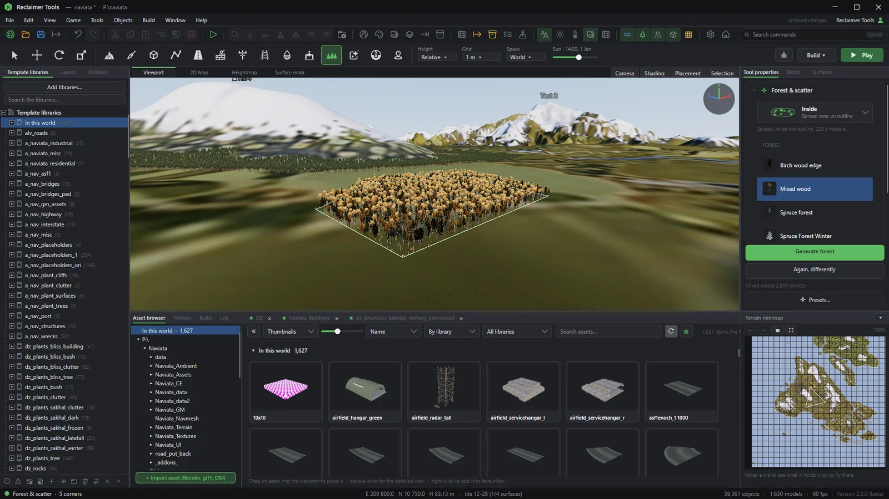
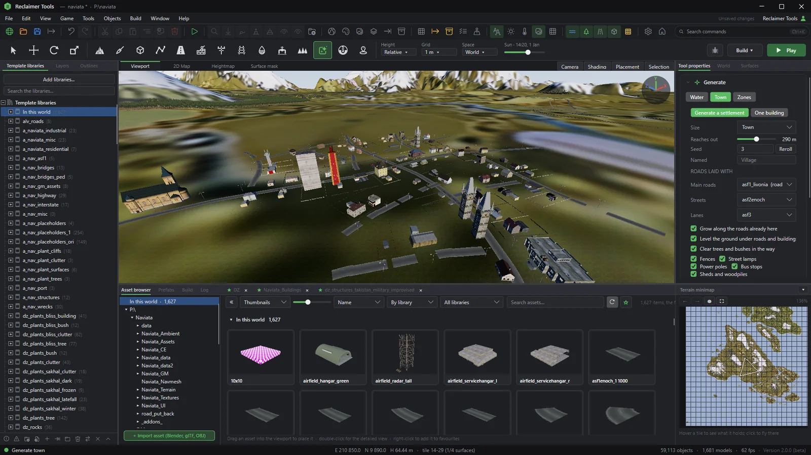
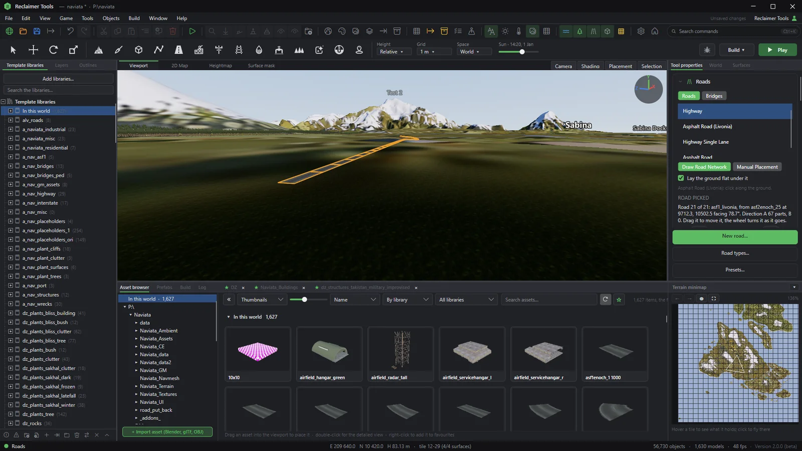
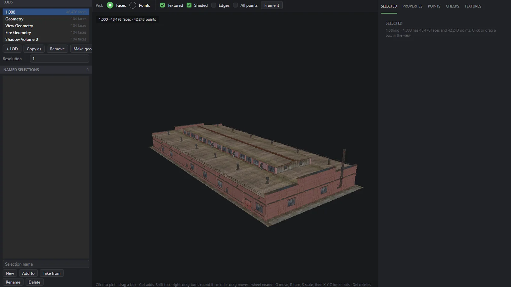
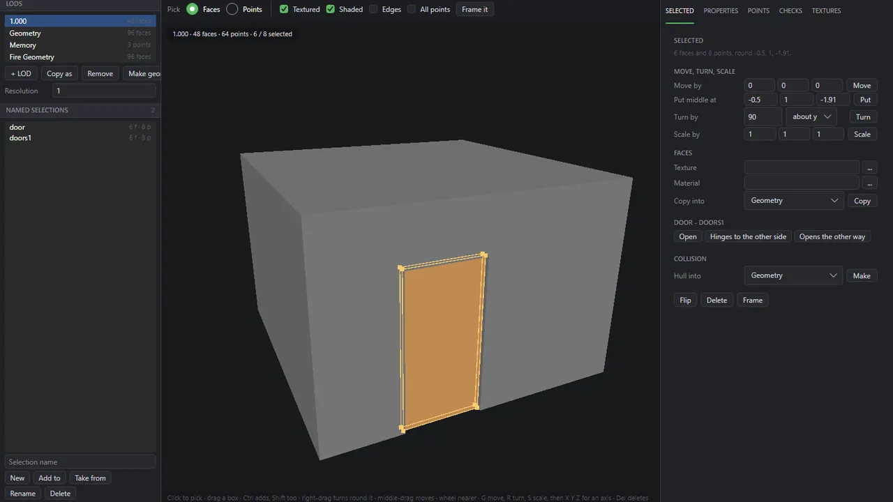
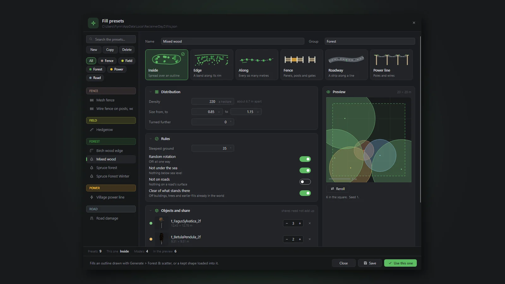

# Reclaimer Tools

**Build DayZ terrains in one place.**

A desktop editor for DayZ Standalone terrains. Open your TerrainBuilder project and sculpt, paint, lay
roads, grow forests, build towns and test in game, all in one window.

[Website](https://reclaimertools.com) · [Download](https://github.com/Naviata/Reclaimer-Releases/releases/latest) ·
[Get a licence](https://reclaimertools.com/licence/) · [Discord](https://discord.gg/s3EKAqc7Nz) ·
[Bug tracker](https://reclaimertools.com/bugs/)

## What it does

- **Your TerrainBuilder project, in 3D.** Open a `.tv4p` with its layers, heightfield and road network,
  and work on the whole world in a lit 3D view.
- **Sculpt, paint and cut holes.** Shape the heightmap, paint surfaces with live checks of each tile, and
  cut terrain holes you can take back.
- **Roads, rail, walls and power.** Draw a line and Reclaimer lays roads, railway, fences, walls, power
  lines, pipes and streams piece by piece.
- **Forests.** Draw an outline, pick a preset, and grow a forest that keeps to the slope and the
  waterline - inside the outline, along its edge, or along a line.
- **Towns.** Plan a village, town or city: streets, lots, buildings facing the street, fences, lamps and
  bus stops, built as one undoable edit.
- **Model Editor.** Open Object Builder `.p3d` models, bring models in from FBX, OBJ or glTF with their
  textures, and make doors that open.
- **Pack and play.** Pack PBOs the way DayZ Tools does, then start DayZ on your terrain.

## See it at work

| | |
|---|---|
|  **Forest scatter** |  **Towns and zones** |
|  **Roads** |  **Model Editor** |
|  **Doors that open** |  **Fill presets** |

## Try it, then join

1. **Download** the latest release: one exe for 64-bit Windows, no installer.
2. **Try it for an hour.** Sign in with a free Patreon account. The clock only runs while Reclaimer is
   in front.
3. **Join on [Patreon](https://www.patreon.com/cw/ReclaimerTools).** A membership unlocks Reclaimer;
   sign in with the same Patreon account.

Reclaimer is still being made: keep backups of your work, and tell us what goes wrong on the
[bug tracker](https://reclaimertools.com/bugs/) or [Discord](https://discord.gg/s3EKAqc7Nz).

## The small print

[Licence terms](EULA.md) · [Privacy policy](PRIVACY.md) · [contact@reclaimertools.com](mailto:contact@reclaimertools.com)

Reclaimer Tools is not affiliated with or endorsed by Bohemia Interactive. DayZ is a trademark of
Bohemia Interactive a.s.
